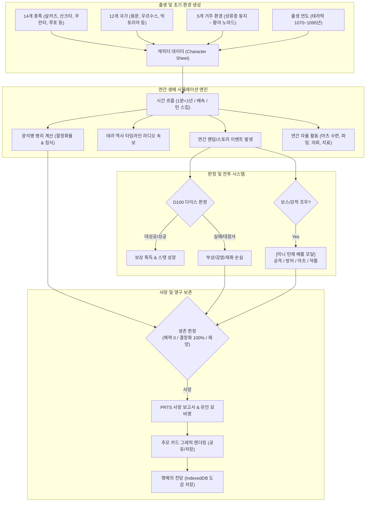
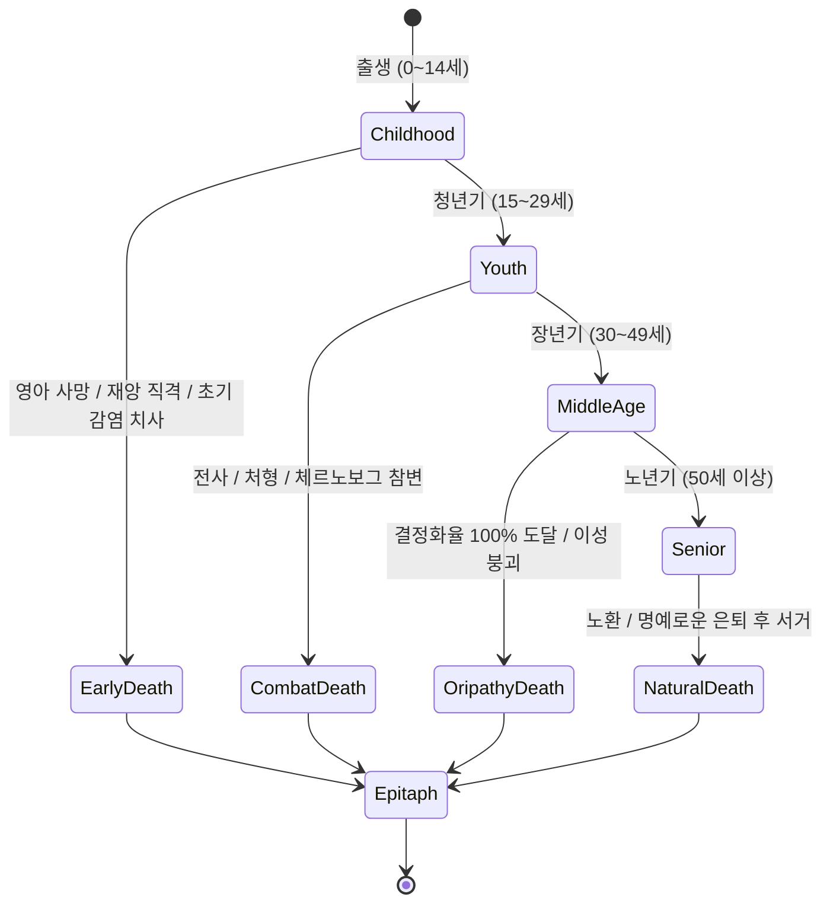

# 테라의 한 사람으로 태어나 (Terra: Life in Arknights) 상세 기획 및 개발 명세서

> **"박사님, PRTS 가동을 시작합니다. 테라의 한 사람으로서 살아가는 여정에 오신 것을 환영합니다."**  
> *"우리는 황야에서 태어나, 재앙의 눈을 마주하고, 오리지늄의 침식을 견디며 역사의 한 조각이 된다."*

---

## 1. 프로젝트 개요 및 핵심 비전 (Vision & Core Philosophy)

### 1.1 기획 배경 및 영감
Project Moon의 텍스트 기반 인생 시뮬레이터인 ['도시의 한 사람으로 태어나'](https://project-moon-life.cityborn.workers.dev/)의 특유의 건조하면서도 몰입감 넘치는 텍스트 문법, 불합리한 세계에서의 처절한 생존기, 선택과 주사위 판정의 묘미를 계승합니다.  
이를 하이퍼그리프(Hypergryph)의 모바일 타워디펜스 RPG **명일방주(Arknights)**의 방대한 **'테라(Terra)' 세계관**과 완벽히 융합하여, 플레이어가 테라의 일개 시민, 용병, 감염자, 기사, 또는 연구원이 되어 한 평생을 살아가다 스러져가는 **텍스트 & RPG 하이브리드 인생 시뮬레이션 웹 게임**을 구축합니다.

### 1.2 핵심 게임플레이 기둥 (Three Pillars)
1. **철저한 세계관 고증 (Arknights Lore Fidelity)**
   - 테라력 1070년~1110년의 실제 타임라인과 대사건(체르노보그 사변, 런디니움 봉쇄, 라인 랩 사건, 이베리아 대해일 등)이 매년 라디오 속보와 개인의 생애에 직접적 충격파를 전달합니다.
   - 14개 이상의 종족 고유 생체 특성(살카즈의 아츠 친화력과 편견, 산크타의 공감각과 수호총, 에기르의 경이로운 신체와 아츠 부재 등)을 시스템화합니다.
2. **광석병(Oripathy)의 양날의 검 시뮬레이션**
   - 단순한 수치 감소가 아닌, 체세포 결정화율(%), 혈중 오리지늄 농도(u/L), 병변 부위(폐, 신경계, 사지 등)로 이루어진 정밀 병리 시스템.
   - 결정화율이 오르면 아츠(Arts)의 위력과 폭발력이 비약적으로 상승하지만, 신체 붕괴와 사회적 차별, 100% 도달 시의 결정화 파열 사망이라는 치명적 리스크가 공존합니다.
3. **하이브리드 템포 & 전술 턴제 배틀의 융합**
   - 1분=1년 실시간 자동 진행의 방치형 몰입감과 함께 1x/2x/4x 배속, 일시정지, '다음 해로 넘기기(수동 턴 스킵)'를 제공합니다.
   - 인생의 갈림길마다 주사위(D100) 판정이 개입하며, 강적과의 사투나 생사의 갈림길에서는 브라우저 모달로 **[미니 턴제 배틀]**이 열려 긴장감을 극대화합니다.

---

## 2. 테라 세계관 심층 고증 및 데이터 아키텍처



### 2.1 테라 연호 타임라인 (1070 ~ 1110)
게임 내 시간은 테라력(Terra Solar Calendar)으로 흐르며, 연도별로 테라 전역의 정세가 요동칩니다.

| 테라 연도 | 역사적 사건명 | 배경 지역 | 게임 내 영향 및 이벤트 연동 |
| :--- | :--- | :--- | :--- |
| **1089~1091** | 카즈델 2차 내전 및 바벨 창설 | 카즈델 | 살카즈 용병 수요 폭증, 바벨 이동함선 지원병 모집, 피난민 급증 |
| **1094** | 우르수스 광산 봉기 전조 | 우르수스 | 감염자 단속 격화, 우르수스 지역 이동도시 감시 강화 |
| **1096** | **체르노보그 사변 (Chernobog Incident)** | 우르수스 | 대규모 재앙 발발, 리유니온 무장봉기. 우르수스 출신자 피난/참전 분기 |
| **1097** | **용문 사변 & 체르노보그 코어 저지** | 용문 / 황야 | 로도스-근위국 연합 작전, 검은 비구름 슬럼가 정화, 탈룰라 결전 |
| **1097** | **카시미어 제24회 메이저 기사 대회** | 카시미어 | 상업연합회의 음모, 마리아 니어 출전, 감염자 기사 저항군 참전 기회 |
| **1098** | **컬럼비아 라인 랩 사건 (Dorothy's Vision)** | 컬럼비아 | 인공 아츠 각성체 실험, 개척지 군부 개입, 연구소 연구원 탈출 의뢰 |
| **1099** | **빅토리아 런디니움 위기 (Crisis of Londinium)** | 빅토리아 | 살카즈 군사위원회(테레시스)의 런디니움 점령, 증기기사 저항, 전시 물자 조달 |
| **1099** | **이베리아 '스툴티페라 나비스' & 대해일** | 이베리아 | 심해의 교단(시본/해사) 침공, 종교재판관의 숙청, 광기의 바다 이벤트 |
| **1100** | **컬럼비아 우주 탐사 프로젝트 '고독한 별'** | 컬럼비아 | 크리스틴 라이트의 인공위성 발사, 테라의 천공 균열, 지식인 계층 각성 |
| **1101+** | **사미 극북 붕괴체의 남하** | 사미 설원 | 데몬(붕괴체)과의 끝없는 사투, 사이클롭스 예언가와의 조우 |

---

### 2.2 14개 종족(Race) 및 고유 생체 특성 명세

테라의 종족은 단순한 외형이 아니라, 생물학적 특성과 사회적 입지를 직접 결정합니다.

```
1. 살카즈 (Sarkaz / 티카즈):
   - 계통: 웬디고, 나흐체러, 뱀파이어, 밴시, 가고일 등 고대 마족의 후예
   - 패시브 [원초의 혈맥]: 오리지늄 아츠 친화력 +30%, 체력 자연회복력 우수
   - 페널티 [천년의 저주]: 광석병 자연 감염률 2배, 이동도시 입국 시 경계/수탈 확률 증가

2. 산크타 (Sankta):
   - 계통: 라테라노의 천사 종족. 머리 위의 광륜(Halo)과 등 뒤의 빛나는 날개
   - 패시브 [공감각 (The Law)]: 이성(Sanity) 최대치 +20, 산크타 간 정신 교감
   - 고유 권한 [수호총 면허]: 전용 화기(수호총) 장착 가능 (원거리 관통 대미지)
   - 특수 규칙: 동족을 사살하거나 계율을 어길 시 '타락(Fallen)'하여 뿔이 돋고 광륜 소멸

3. 쿠란타 (Kuranta):
   - 계통: 말 종족. 카시미어 기사도의 주축
   - 패시브 [질풍의 기동]: 회피율 +15%, 이동/추격 시 주사위 보정 +10
   - 히든 혈통: 5% 확률로 '페가수스(Pegasus)' 또는 '나이트메어' 고대 혈통 각성

4. 루포 (Lupo):
   - 계통: 늑대 종족. 시라쿠사 마피아의 핵심
   - 패시브 [사냥꾼의 본능]: 치명타율 +15%, 단독 생존 시 공격력 +20%
   - 페널티 [패밀리의 굴레]: 시라쿠사 마피아 세력의 피의 복수 이벤트 빈발

5. 펠린 (Feline):
   - 계통: 고양이과 종족. 빅토리아 및 용문에 다수 거주
   - 패시브 [유연한 도약]: 위험 회피 및 기습 판정 성공률 +20%, 도심 밀수 특화

6. 에기르 (Aegir):
   - 계통: 심해에서 기원한 초고대 해양 문명 종족
   - 패시브 [완전 생체 신체]: 기본 전투력 및 신체 스탯 +25%, 질병 저항력 극상
   - 특수 제약 [아츠 불모]: 오리지늄 아츠 적성 고정 0 (대신 첨단 기계공학 및 순수 물리력 극대화)
   - 위험 요소 [바다의 부름]: 시본(해사) 조우 시 정신 붕괴(SAN 급감) 위험

7. 우르수스 (Ursus):
   - 계통: 곰 종족. 북방 제국의 거한들
   - 패시브 [설원의 강철]: 최대 체력(HP) +30%, 혹한 및 기절 저항, 중화기 특화

8. 리베리 (Liberi):
   - 계통: 조류 종족. 라테라노, 이베리아, 컬럼비아 등 폭넓은 분포
   - 패시브 [비상의 직관]: 명중률 +20%, 선제 공격권 획득 확률 증가

9. 포르테 (Forte):
   - 계통: 소 종족. 우직한 인내력과 완력
   - 패시브 [철벽의 육신]: 방어력 +25%, 방패 및 중갑 장비 착용 시 물리 피해 30% 흡수

10. 카프리니 (Caprinae):
    - 계통: 염소 종족. 라이타니엔의 학자와 음악가들
    - 패시브 [음률의 조율]: 복합 오리지늄 아츠 영창 속도 및 효과 범위 +25%

11. 엘라피아 (Elafia):
    - 계통: 사슴 종족. 사미 설원 및 빅토리아 귀족
    - 패시브 [원초의 영감]: 이성 회복 속도 2배, 정신 오염 저항력 보유

12. 아나티 / 페로 / 불포 (Anaty / Perro / Vulpo):
    - 계통: 족제비, 개, 여우 종족. 재치와 사교성, 정보 수집(INTEL) 스탯 +20%

13. 드라코 & 아슬란 (Draco & Aslan - 극희귀 고대종, 출생 확률 각 0.5%):
    - 드라코: 불꽃의 정통 아츠, 절대적 카리스마, 빅토리아 왕위 계승권
    - 아슬란: 사자의 제왕적 체격, 통솔력 극대화, 황실 수호 기사 특성
```

---

### 2.3 12개 국가(Nation) 및 5개 거주 환경(Environment)

#### 국가별 고유 경제/정치 환경
1. **용문 (Lungmen)**: 웨이 옌우 총독의 독립 무역 이동도시. LMD 획득 기회 최다, 치안 우수(근위국), 단 빈민가(슬럼)의 극단적 차별.
2. **우르수스 제국 (Ursus)**: 군국주의 제국. 가혹한 광산 강제노동, 감염자 공개 처형, 귀족 군벌의 암투, 리유니온의 발상지.
3. **빅토리아 (Victoria)**: 증기 기관과 귀족 공작들의 제국. 런디니움 수도, 타라 분리주의 세력, 살카즈 군사위원회 점령기.
4. **컬럼비아 (Columbia)**: 자유와 개척, 첨단 자본주의 공화국. 라인 랩(생체공학), 블랙스틸(군사기업), 돈만 있으면 무엇이든 가능한 기회의 땅.
5. **카즈델 (Kazdel)**: 살카즈들의 폐허이자 영원한 전장. 중앙 정부 부재, 용병 계약, 무법지대, 끝없는 피의 복수.
6. **라테라노 (Laterano)**: 교황청과 율법의 낙원. 디저트와 축제, 산크타와 리베리의 성지, 엄격한 출입국 심사.
7. **이베리아 (Iberia)**: '대침묵' 이후 황폐해진 해양 황금향. 이베리아 종교재판소의 잔혹한 이단 심문, 심해 시본의 침식.
8. **카시미어 (Kazimierz)**: 기사도 전통이 상업연합회의 자본주의 스포츠 쇼(기사 메이저)로 전락한 나라. 감염자 지하 결투장.
9. **사미 (Sami)**: 설원과 빙하의 땅. 사이클롭스 점술가, 스노우프리스트, 극북 미지의 '붕괴체(Demon)'와의 최전선.
10. **쉐라그 (Kjerag)**: 삼대 가문(카란 무역회사 실버애쉬 가문)과 만주원의 대립, 성산의 종교적 안식.
11. **시라쿠사 (Siracusa)**: 12개 마피아 패밀리가 법 위에 군림하는 도시. 비 오는 골목, 복수극, 오페라 극장.
12. **염국 (Yan)**: 고대 동방 대제국. 천사(司)의 파편 '수이(Sui)'의 12 형제, 대리(사법기관), 묵향과 무협의 세계.

#### 5개 거주 환경 (Environment)
- **[이동도시 핵심 상류 구역 (Core High-Class District)]**: 초기 자금 +3,000 LMD, 안전한 치안, 단 감염 판정 즉시 모든 재산 몰수 및 강제 추방.
- **[일반 거주 구역 (Civic Residential Block)]**: 표준 스탯, 시민권 보유, 평범하고 안정적인 성장.
- **[슬럼가 / 언더그라운드 (Slums & Black Market)]**: 감염 위험 +30%, 범죄율 높음, 그러나 암시장 및 뒷골목 의뢰 접근 용이.
- **[황야 개척 캠프 / 노마드 (Wasteland Nomad Camp)]**: 이동도시 밖 방랑 부족. 상시 재앙 노출, 생존력 +20, 물자 부족.
- **[이동 함선 / 특수 기지 (Mobile Base - 로도스/블랙스틸)]**: 전문 훈련 기회, 초기 광석병 억제제 보급, 위험 임무 파견.

---

### 2.4 8대 핵심 진영 및 평판 (Faction Reputation)
플레이어의 선택과 의뢰 완수에 따라 각 진영의 우호도(-100 ~ +100)가 변동합니다.

1. **로도스 아일랜드 (Rhodes Island)**: 오리지늄 연구 및 치료, 억제제 공급, 정예 오퍼레이터 특채 기회.
2. **리유니온 무브먼트 (Reunion Movement)**: 감염자 무장 해방 전선. 우르수스/용문 체제 전복 시 합류 가능.
3. **용문 근위국 (L.G.D.)**: 첸과 스와이어가 이끄는 치안 기구. 범죄 척결 및 안정적인 급여.
4. **라인 생명 (Rhine Lab)**: 첨단 과학, 오리지늄 공학, 생체 실험(위험하지만 막대한 보상).
5. **블랙스틸 월드와이드 (Blacksteel Worldwide)**: 컬럼비아의 민간 군사 기업(PMC). 전술 사격 및 용병 파견.
6. **살카즈 군사위원회 (Military Commission of Kazdel)**: 테레시스 직속 군단. 카즈델 재건 및 빅토리아 점령군.
7. **이베리아 종교재판소 (Iberian Inquisition)**: 재판관들의 엄정한 처형대. 심해 이단 척결.
8. **카시미어 상업연합회 (Kazimierz General Chamber of Commerce)**: 메이저 대회의 스폰서 및 자본 카르텔.

---

## 3. 게임 코어 메커니즘 상세 사양

### 3.1 광석병(Oripathy) 4단계 병리 시뮬레이터

광석병은 본 게임의 가장 핵심적인 서사적/시스템적 갈등 요소입니다.

```typescript
export interface OripathyStatus {
  isInfected: boolean;
  crystallizationRate: number;      // 0.0% ~ 100.0% (체세포 오리지늄 결정화율)
  originiumBloodDensity: number;    // 0.05 ~ 1.20+ u/L (혈중 오리지늄 농도)
  stage: 'NonInfected' | 'Early' | 'Mid' | 'Severe' | 'Terminal' | 'Crystallized';
  lesionSite: 'None' | 'Respiratory' | 'Nervous' | 'Vascular' | 'Musculoskeletal';
  activeArtsMultiplier: number;     // 아츠 위력 증폭 배율 (1.0x ~ 3.5x)
  suppressantDoseLeft: number;      // 잔여 억제제 약효 턴 수
}
```

#### 병기별 임상 증상 및 시스템 페널티/버프

| 병기 단계 | 결정화율 범위 | 임상 특징 및 페널티 | 시스템 버프 (양날의 검) |
| :--- | :--- | :--- | :--- |
| **비감염 (Clean)** | `0.0%` | 혈중 농도 0.08~0.12 u/L. 이동도시 자유 출입, 사회적 차별 없음. | 정상 신체 유지 |
| **초기 (Early)** | `0.1% ~ 9.9%` | 표피에 미세한 흑색 결정 형성. 간헐적 통증. 재검사 시 감염 발각 가능성. | 아츠 위력 +25% |
| **중기 (Mid)** | `10.0% ~ 29.9%` | 신체 겉면에 뚜렷한 결정화. 이동도시 입국 금지/추방, 정기적 이성(SAN) -5 소모. | 아츠 위력 +60%, 신체 방어력 +10% |
| **중증 (Severe)** | `30.0% ~ 59.9%` | 내장기 및 주요 혈관 침식. 연간 최대 체력 -5, 호흡곤란/발작 이벤트. | 아츠 위력 +120%, 아츠 스킬 범위 증가 |
| **말기 (Terminal)** | `60.0% ~ 99.9%` | 뼈와 신경망의 전신 결정화. 수명 한계선. 매년 생존 다이스 판정 강제. | 아츠 위력 +250%, 초고위험 금지 아츠 해금 |
| **결정화 파열 (Dead)**| `100.0%` | **전신 결정화 붕괴 사망**. 2차 감염 분진을 뿜으며 생애 종료. | - |

#### 치료 및 관리 아이템
- **로도스 아일랜드 정품 억제제 (Rhodes Suppressant)**: 결정화율 진행 3년간 완전 동결, 혈중 농도 -0.05 u/L 완화 (가격: 800 LMD).
- **암시장 불법 복제약 (Black Market Fake)**: 저렴하나(200 LMD) 40% 확률로 간 손상(최대 체력 영구 -10) 및 이성 폭락.
- **오리지늄 활성제 (Hazardous Catalyst)**: 즉시 체포 결정화율 +5.0% 급증, 단 1회 전투 동안 아츠 공격력 400% 폭증.

---

### 3.2 7대 핵심 스탯 & D100 주사위 판정 테이블

캐릭터는 다음 7가지 기본 스탯(0 ~ 100)을 갖습니다.
1. **체력 (HP)**: 0이 되면 사망 판정 돌입.
2. **이성 (SAN)**: 0이 되면 광기/패닉/방랑 상태 돌입.
3. **자금 (LMD)**: 용문폐. 장비, 치료제, 이동도시 승차권 구매.
4. **전투력 (ATK)**: 물리 전투, 무기 숙련도, 근접 격투 판정.
5. **아츠 적성 (ARTS)**: 오리지늄 아츠 연산력, 주문 파괴력.
6. **정세 감각 (INTEL)**: 정보 수집, 사기 회피, 세력 교섭.
7. **운 (LUCK)**: 치명타 확률, 암시장 희귀 발견, 재앙 회피.

#### D100 판정 4단계 매트릭스
모든 선택지는 다음과 같이 판정됩니다:  
`Final Roll = 1d100 + (해당 스탯 / 5) + 종족/직업 보너스 vs 난이도(DC)`

- **대성공 (Critical Success / Roll 95+)**:
  - 결과: 완벽한 대성공. 스탯 +5~10 영구 상승, 전설 장비/칭호 획득, 특수 분기 해금.
- **성공 (Success / Roll >= DC)**:
  - 결과: 의도한 목표 달성. 보상 LMD 획득, 명성 상승.
- **실패 (Failure / Roll < DC)**:
  - 결과: 실패. 체력/이성 손실(-10~25), 부상 디버프, 평판 하락.
- **대참사 (Catastrophe / Roll <= 5)**:
  - 결과: 끔찍한 파국. 광석병 감염, 주요 신체 결손, 파산, 동료 상실, 즉사 위기.

---

### 3.3 연간 자율 활동 시스템 (Annual Free Actions)

매년(턴) 플레이어는 **활동 포인트(Action Point: 기본 1~2점)**를 소모하여 원하는 활동을 직접 지시할 수 있습니다. 텍스트 로그가 흘러가는 것을 구경만 하는 것이 아니라 능동적인 생애 개척이 가능합니다.

```
[연간 자율 활동 탭 구성]
1. 오리지늄 아츠 수련 (Arts Cultivation):
   - 아츠 유닛 조율 및 영창 훈련
   - 속성 영창 습득: [열량 화염], [고전도 전격], [중력 압축], [정신 간섭], [치유 파동]
   - 결과: ARTS 스탯 상승, 신규 배틀 액티브 스킬 해금

2. 전술 훈련 및 암시장 파밍 (Tactical Training & Armory):
   - 블랙스틸 사격술 훈련 (ATK 상승)
   - 암시장 장비 구매:
     * 근접: 런디니움 제식 도검, 살카즈 대검, 카시미어 기사창
     * 원거리: 컬럼비아제 산탄총, 라테라노 개조 수호총 (산크타 전용)
     * 방어구: 강화 케블라 코트, 증기 중갑, 방진 방호복 (감염 저항)

3. 세력 의뢰 수주 (Faction Missions):
   - [로도스 아일랜드 의뢰]: 감염자 구조 및 수송 (보상: 억제제, 평판)
   - [용문 근위국 특별 순찰]: 슬럼가 치안 유지 (보상: 높은 LMD)
   - [펭귄 로지스틱스 비밀 배송]: 초고속 위험 배달 (스릴, LUCK 판정, 대박 보상)
   - [카즈델 용병 계약]: 목숨을 건 전장 참전 (고위험 고수익, 전투 돌입)

4. 의료 및 광석병 케어 (Medical Clinic):
   - 로도스 이동 진료소 방문: 정품 억제제 투약 (결정화율 억제)
   - 건강 검진: 혈중 농도 정밀 계측 및 잠재 병변 부위 사전 파악
   - 정신 상담: 이성(SAN) +30 회복

5. 휴양 및 문화생활 (Recreation & Sanity):
   - 시에스타 음악제 참관: 이성 완전 회복, 행운 버프
   - 라이타니엔 오페라 감상: 교양 및 정세 감각(INTEL) 상승
   - 쉐라그 만년설 온천 요양: 최대 체력 회복
```

---

### 3.4 미니 턴제 배틀 모달 (Mini Tactical Combat Engine)

역사의 대사건이나 인생의 결정적 고비(암살자 기습, 리유니온과의 교전, 시본의 습격, 보스전)에서는 화면 중앙에 **[전술 배틀 모달]**이 전개됩니다.

```
+-------------------------------------------------------------+
| [BATTLE] 런디니움 외곽 - 살카즈 군사위원회 특수부대 조우!    |
+-------------------------------------------------------------+
| ENEMY: 살카즈 원통(Centurion) 중갑 지휘관                     |
| HP [████████████████░░░░] 640/800   SP [████░]              |
| 상태: [아츠 실드 가동 중] - 물리 피해 40% 감소              |
+-------------------------------------------------------------+
| YOU: 아츠 적성 A+ / 광석병 중기 (체세포 결정화율 24.5%)      |
| HP [██████████░░░░░░░░░░] 120/250   SAN [████████░░] 42/60  |
+-------------------------------------------------------------+
| 전술 커맨드:                                                |
| [1. 물리 공격]   런디니움 단검 연타 (ATK 비례 물리 타격)    |
| [2. 오리지늄 아츠] [화염 소나타] 영창 (SAN -10, 광석병 위력)|
| [3. 전술 방어]   피해 50% 경감 & 반격 카운터 준비           |
| [4. 전술 물자]   응급 스프레이 (HP +80) / 섬광 수류탄       |
+-------------------------------------------------------------+
| 전투 로그:                                                  |
| > 당신의 화염 아츠가 적의 중갑을 용융시켰습니다! (피해 184) |
| > 적이 대검을 휘둘러 당신의 어깨를 베었습니다! (피해 45)     |
+-------------------------------------------------------------+
```

#### 전투 커맨드 시스템
1. **[물리 공격 (Physical Strike)]**: 장착 무기 기반 타격. 적의 아츠 저항이 높을 때 효과적.
2. **[오리지늄 아츠 (Originium Arts)]**: 이성(SAN)을 소모하여 발동. 캐릭터의 감염도(%)가 높을수록 피해 배율이 1.5배~3.0배까지 폭증.
3. **[전술 방어 & 간파 (Defend & Evade)]**: 다음 턴 받는 피해 50% 감소 및 기절 저항, 공격 회피 시 SP 충전.
4. **[전술 물자 (Items)]**: 응급 붕대, 고농도 이성제, 섬광탄, 오리지늄 활성제 사용.
5. **[패주 / 후퇴 (Retreat)]**: 운(LUCK)과 기동성(쿠란타/펠린 보너스) 기반 도주 시도. 실패 시 확정 피격.

---

## 4. 방대한 이벤트 트리 및 시나리오 분기 설계

### 4.1 생애 주기별 이벤트 아키텍처



#### 1. 유년기 (0 ~ 14세)
- **출생의 멍에**: 거주 환경과 부모의 신분에 따른 초기 이벤트 (부모의 오리지늄 분진 피폭 여부, 이동도시 시민권 등록 vs 슬럼가 무국적자).
- **종족 각성**: 산크타의 수호총 첫 수여식, 살카즈 혈통의 첫 아츠 폭주, 에기르 아이의 악몽.
- **감염의 첫 위기**: 이동도시 하층 쓰레기장에서 오리지늄 원석 조각을 주웠을 때의 선택.

#### 2. 청년기 (15 ~ 29세): 직업 및 진로 결정
- **직업(Career) 분기**:
  - `로도스 아일랜드 견습 오퍼레이터`: 정규 훈련, 의료 혜택, 위험한 전장 파견.
  - `용문 근위국 경사`: 슬럼가 단속, 흑방과의 타협 vs 청렴한 공무원의 길.
  - `카즈델 자유 용병`: 돈을 좇아 테라 전역의 전쟁터를 전전하는 삶.
  - `카시미어 독립 기사`: 기사 메이저 토너먼트 출전, 팬클럽과 승부조작의 유혹.
  - `라인 랩 첨단 연구원`: 연구비 횡령, 비밀 생체공학 프로젝트 참여, 군부와의 결탁.
  - `시라쿠사 패밀리 말단 조직원`: 피의 맹세, 찻집과 나이트클럽 관리, 암살 지령.
  - `황야의 대상인 / 밀수업자`: 이동도시 간 물자 수송, 샌드비스트 습격 방어.

#### 3. 장년기 (30 ~ 49세): 조직의 주축과 거대한 사건
- **역사의 격류 개입**:
  - 1096년 체르노보그 함락 현장에 있었는가? (탈출 vs 리유니온 가담 vs 시민 구출)
  - 1099년 런디니움 공방전에서 살카즈 군사위원회에 맞서는가, 협력하는가?
- **체내 오리지늄의 심화**: 30대에 접어들며 결정화율이 급격히 증가. 정기적인 억제제 비용 감당 여부에 따른 생사의 갈림길.
- **후계자 양성 / 전설의 무기 습득**: 고유 칭호("외눈의 살카즈 사신", "용문의 검은 그림자", "런디니움의 수호자") 획득.

#### 4. 노년기 (50세 이상): 불멸의 전설 혹은 조용한 황혼
- 대다수의 테라 거주민이 40대를 넘기지 못하는 가혹한 세계에서, 50세 이상 생존 시 **'살아있는 전설'** 버프 획득.
- 광석병 억제 성공 시 평화로운 은퇴, 혹은 후세대를 위한 마지막 장렬한 희생 선택지.

---

## 5. 데이터 스키마 (TypeScript Interfaces)

```typescript
// 1. 캐릭터 인터페이스
export interface Character {
  id: string;
  name: string;
  gender: '남성' | '여성';
  race: string;
  subRace?: string;               // 웬디고, 뱀파이어, 페가수스 등
  nation: string;
  environment: '상류층 둥지' | '일반 거주구' | '슬럼가' | '황야 노마드' | '이동기지';
  age: number;
  year: number;                  // 테라력 (1070 ~ 1110)
  
  // 기본 능력치 (0 ~ 100)
  health: number;
  maxHealth: number;
  sanity: number;
  maxSanity: number;
  wealth: number;                // 용문폐 (LMD)
  combat: number;                // 전투 숙련도
  artsAptitude: number;          // 아츠 적성
  intellect: number;             // 정세 감각
  luck: number;                  // 행운
  
  // 광석병 상태
  oripathy: OripathyStatus;
  
  // 진영 및 소속
  factions: Record<string, number>; // 진영별 평판 (-100 ~ 100)
  career: string;                   // 직업
  careerRank: string;               // 직급
  titles: string[];                 // 획득 칭호
  
  // 장비 및 인벤토리
  equipment: {
    weapon?: EquipmentItem;
    armor?: EquipmentItem;
    accessory?: EquipmentItem;
  };
  inventory: InventoryItem[];
  
  // 생사 상태
  isAlive: boolean;
  deathRecord?: DeathRecord;
}

// 2. 장비 및 아이템
export interface EquipmentItem {
  id: string;
  name: string;
  type: 'weapon' | 'armor' | 'accessory';
  atkBonus?: number;
  defBonus?: number;
  artsBonus?: number;
  specialTrait?: string;
  rarity: 1 | 2 | 3 | 4 | 5 | 6;
}

export interface InventoryItem {
  id: string;
  name: string;
  count: number;
  description: string;
  category: 'medicine' | 'consumable' | 'material' | 'special';
  useEffect?: string;
}

// 3. 게임 이벤트
export interface GameEvent {
  id: string;
  minAge: number;
  maxAge: number;
  title: string;
  description: string;
  category: 'life' | 'oripathy' | 'world_news' | 'combat' | 'fateful';
  conditions?: {
    isInfected?: boolean;
    race?: string[];
    nation?: string[];
    minCombat?: number;
    minArts?: number;
    requiredYear?: number;
  };
  choices: EventChoice[];
}

export interface EventChoice {
  label: string;
  description: string;
  requirements?: {
    stat?: keyof Character;
    minVal?: number;
    itemCost?: { itemId: string; count: number };
    lmdCost?: number;
  };
  diceCheck?: {
    stat: 'combat' | 'artsAptitude' | 'sanity' | 'wealth' | 'intellect' | 'luck';
    difficulty: number; // DC (기본 난이도 1~100)
  };
  outcomes: {
    criticalSuccess?: OutcomeResult;
    success: OutcomeResult;
    failure: OutcomeResult;
    criticalFailure?: OutcomeResult;
  };
  triggerBattleEnemyId?: string; // 전투 진입 시 적 ID
}

export interface OutcomeResult {
  text: string;
  effects: {
    healthDelta?: number;
    sanityDelta?: number;
    wealthDelta?: number;
    combatDelta?: number;
    artsDelta?: number;
    crystallizationDelta?: number; // 결정화율 변동
    addItems?: string[];
    addTitles?: string[];
    repDeltas?: Record<string, number>;
  };
}

// 4. 사망 및 추모 기록 (Hall of Fame)
export interface DeathRecord {
  yearOfDeath: number;
  ageAtDeath: number;
  cause: 'OripathyCrystallization' | 'KilledInAction' | 'CatastropheDisaster' | 'SanityBreakdown' | 'OldAge' | 'Executed';
  detailedCause: string;
  finalRank: 'S' | 'A' | 'B' | 'C' | 'D' | 'F';
  lastWords: string;
  notableAchievements: string[];
  finalStatsSummary: {
    combat: number;
    arts: number;
    wealth: number;
    crystallizationRate: number;
  };
}
```

---

## 6. UI/UX 디자인 시스템 & 듀얼 비주얼 테마

본 프로젝트는 사용자의 취향에 따라 **2가지 극명한 비주얼 테마**를 실시간으로 전환할 수 있습니다.

### 6.1 테마 A: 로도스 PRTS 터미널 테마 (기본값)
- **컨셉**: 명일방주 오퍼레이터 인사 기록부 및 작전 지휘 터미널
- **색상 팔레트**:
  - Main Background: Carbon Dark (`#0b0d11`, `#13171f`)
  - Accent Color: Rhodes Electric Cyan (`#00e5ff`)
  - Warning/Hazard: Industrial Amber Yellow (`#f7b500`, `#ff3d00`)
  - Text: Medical Crisp White (`#e2e8f0`), Sub-text (`#64748b`)
- **컴포넌트 특징**:
  - 심전도(ECG) 펄스 애니메이션 HUD (체력 및 이성에 따라 파형 속도 변화)
  - 각진 테크니컬 프레임, 바코드 데코레이션, 경고 알람 점멸 효과
  - CRT 모니터 미세 스캔라인 텍스처 (옵션 토글)

### 6.2 테마 B: 테라 역사서 고서적 테마 (전환 토글)
- **컨셉**: '도시의 한 사람' 감성의 앤틱 양장본 양피지 일지
- **색상 팔레트**:
  - Main Background: Aged Parchment (`#f4ecd8`, `#e8dcbe`)
  - Frame & Borders: Dark Leather Brown (`#2c1810`, `#4a2c1d`)
  - Text: Vintage Dark Ink (`#1a1412`, `#3d2f2b`)
  - Accent: Royal Wax Seal Crimson (`#8b1e1e`)
- **폰트 & 감성**:
  - 웹 폰트: Song Myung (송명), 명조 계열
  - 만년필 잉크로 써내려가는 듯한 서정적 텍스트 애니메이션

---

## 7. 엔딩, 묘비명(Epitaph) 및 추모실 (Hall of Fame)

### 7.1 PRTS 사망 진단서 및 묘비명 렌더링
캐릭터가 사망하면, 심전도 모니터의 급격한 플랫라인(삐- 소리 효과)과 함께 **PRTS 최종 사망 보고서**가 출력됩니다.

```
+-----------------------------------------------------------+
| [PRTS-BIO-REPORT #1098-4421]                              |
| 생체 신호 정지 확인 (VITAL SIGNS CEASED)                   |
+-----------------------------------------------------------+
| 대상: 카즈델 출신 살카즈 용병 '발터' (향년 34세)            |
| 최종 계급: [A] - '런디니움의 붉은 늑대'                    |
| 사망 원인: 런디니움 3번 구획 교전 중 증기기사 포격에 전사 |
| 최종 결정화율: 48.2% (중증 감염)                           |
+-----------------------------------------------------------+
| [유언 (Epitaph)]                                          |
| "비구름이 걷히는군... 고향의 하늘도 이런 색이었던가."     |
+-----------------------------------------------------------+
| [업적 기록]                                               |
| - 1096년 체르노보그 난민 42명 구출                        |
| - 살카즈 백부장과의 일기토 승리                           |
| - 로도스 아일랜드 비밀 수송 작전 완수                     |
+-----------------------------------------------------------+
| [클립보드 복사]    [이미지 다운로드 (.png)]    [추모실 보존]|
+-----------------------------------------------------------+
```

### 7.2 영구 보존 및 명예의 전당 (Hall of Fame)
- `IndexedDB`를 활용하여 플레이어가 생성하고 생을 마감한 모든 캐릭터들의 일대기 데이터를 브라우저에 영구 보존합니다.
- 추모실 뷰에서 종족별, 국가별, 사망 원인별 필터링과 상세 일지 재열람을 지원합니다.
- `html-to-image`를 통해 언제든 깔끔한 규격의 SNS 공유용 카드 이미지를 1클릭 다운로드할 수 있습니다.

---

## 8. 단계별 세부 구현 로드맵 (Detailed Roadmap)

### Phase 1: 세계관 DB 및 프로젝트 환경 세팅 (완료 및 기반 구축)
- [x] 테라 세계관 기획 명세서 및 시스템 아키텍처 완성 (`PLAN.md`)
- [ ] Vite + React 18 + TypeScript + Tailwind CSS 프로젝트 스캐폴딩
- [ ] Lucide React, Canvas-confetti, html-to-image 등 필수 라이브러리 구성
- [ ] 테라 세계관 상수 DB 구축 (`races.ts`, `nations.ts`, `factions.ts`, `timeline.ts`)

### Phase 2: 광석병 엔진 & 코어 상태 관리 (Core State Engine)
- [ ] Zustand / React Context 기반의 고성능 전역 캐릭터 상태 스토어 구현
- [ ] 광석병 4단계 병리 계산기 (결정화율, 혈중농도, 약효 감소 알고리즘) 구현
- [ ] 하이브리드 시간 제어 엔진 (1분=1년 실시간 자동 진행 + 1x/2x/4x 배속 + 수동 턴 스킵)
- [ ] D100 주사위 롤러 및 난이도 판정 엔진 구현

### Phase 3: 방대한 이벤트 풀 및 자율 활동 시스템 (Events & Actions)
- [ ] 생애 주기별 (유년기/청년기/장년기/노년기) 100+개 이상의 시나리오 이벤트 데이터 작성
- [ ] 테라 역사 타임라인 대사건 (체르노보그, 런디니움, 라인랩 등) 연동 라디오 속보 시스템 구현
- [ ] 연간 자율 활동 5종 (아츠 수련, 암시장 파밍, 의뢰 수주, 의료 관리, 휴식) 모듈 구현

### Phase 4: 미니 턴제 배틀 모달 (Tactical Combat Modal)
- [ ] 턴제 전투 시스템 엔진 (적 AI, 플레이어 커맨드, 데미지 계산식)
- [ ] 아츠 위력 감염도(%) 연동 증폭 공식 적용
- [ ] 전술 아이템(스프레이, 활성제) 및 방어/간파 커맨드 처리
- [ ] 승리/패배/도주 분기 및 전투 결과 반영

### Phase 5: UI/UX 대시보드 & 듀얼 테마 구현
- [ ] PRTS 터미널 UI 레이아웃 (심전도 바이탈 모니터, 각진 테크니컬 HUD)
- [ ] 테라 역사서 고서적 테마 구현 (양장본 텍스처, 송명체, 양피지 뷰)
- [ ] 타자기 텍스트 출력 효과 및 긴급 경보(Hazard) 시각 피드백 구현

### Phase 6: 사망 진단서, 공유 카드 및 추모실 (Hall of Fame)
- [ ] 사망 판정 매트릭스 및 PRTS 사망 보고서 렌더링
- [ ] `html-to-image` 기반 추모 카드 PNG 이미지 다운로드 & 클립보드 복사
- [ ] `IndexedDB` / LocalStorage 연동 과거 생애 도감 및 추모실 브라우저 구현

### Phase 7: 빌드 검증 및 GitHub Pages 배포
- [ ] 프로덕션 빌드 최적화 (`npm run build`)
- [ ] GitHub Pages 배포 워크플로우 검증 및 라이브 링크 생성
- [ ] 모바일/태블릿 반응형 UI 점검 및 최종 폴리싱