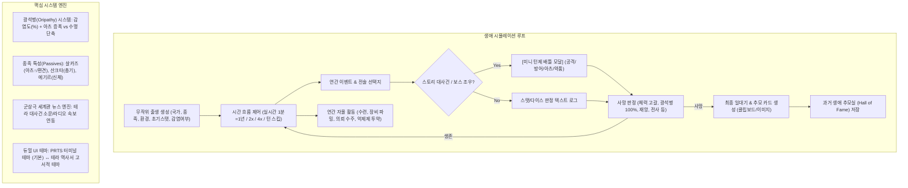

# 테라의 한 사람으로 태어나 (Terra: Life in Arknights) 상세 계획서

## 1. 개요 및 기획 배경
Project Moon의 텍스트 기반 인생 시뮬레이터인 ['도시의 한 사람으로 태어나'](https://project-moon-life.cityborn.workers.dev/)의 독창적인 텍스트 서사 및 인생 시뮬레이션 문법을 계승하면서, **명일방주(Arknights) 세계관인 '테라(Terra)'에 완벽히 맞춘 고유 웹 애플리케이션**을 제작합니다.

플레이어는 테라의 12개 이상 국가(용문, 우르수스, 카즈델, 컬럼비아 등)와 다양한 종족(살카즈, 산크타, 쿠란타, 루포 등), 신분 및 감염 여부를 무작위로 배정받아 태어납니다. 현실 시간 1분=게임 속 1년의 실시간 흐름(또는 턴 스킵/배속) 속에서, 체력/이성/LMD/아츠 적성/전투력과 함께 **광석병 감염도(%)**를 관리하며 살아갑니다.
원작의 방대한 군상극 서사(체르노보그 사변, 라인 랩 사건, 런디니움 위기 등)가 소문과 사건으로 얽히며, 일상적인 전술 선택지 판정 외에도 인생의 결정적 고비에서는 **[미니 턴제 배틀 모달]**이 펼쳐집니다. 사망 시에는 생애를 기리는 추모 카드 및 일대기를 생성·공유하고, 지난 생애 기록 도감에 보존됩니다.

---

## 2. 게임 아키텍처 및 라이프사이클



---

## 3. 핵심 세계관 및 시스템 명세

### 3.1 종족 (Races)
1. **살카즈 (Sarkaz)**: 아츠 친화력 대폭 증가, 기본 체력 우수, 단 비감염자 비율 낮음 및 특정 도시에서 편견/감시 페널티.
2. **산크타 (Sankta)**: 수호총 사용 가능, 정신력/이성 안정성 높음, 라테라노 특수 이벤트.
3. **쿠란타 (Kuranta)**: 높은 기동성과 강인한 신체, 카시미어 기사도 이벤트 연계.
4. **페라인 (Feline)**: 민첩성과 반사신경, 도심 은신 및 범죄 회피 능력.
5. **루포 (Lupo)**: 높은 전투 본능과 무기 숙련, 시라쿠사 패밀리 연계.
6. **에기르 (Aegir)**: 뛰어난 신체 능력과 정신적 복원력, 심해/시본 이벤트 조우율.
7. **우르수스 / 포르테 / 카프리니 / 리베리 / 엘라피아 / 드라코**: 각 종족별 고유 능력치 보너스.

### 3.2 국가 및 지역 (Nations & Regions)
1. **용문 (Lungmen)**: 상업과 치안의 도시, LMD 획득 기회 풍부, 근위국 및 슬럼가 빈부격차.
2. **우르수스 (Ursus)**: 혹독한 추위와 군부의 지배, 광산 강제노동 및 감염자 탄압 극심, 반란의 불씨.
3. **컬럼비아 (Columbia)**: 개척과 첨단 과학, 자본주의, 라인 랩과 개척단 기회.
4. **카즈델 (Kazdel)**: 폐허와 끊이지 않는 내전, 용병들의 고향, 비정하고 치열한 전장.
5. **빅토리아 (Victoria)**: 증기 기관과 귀족 정치, 런디니움의 권력 투쟁.
6. **라테라노, 시에스타, 이베리아, 카시미어, 사미, 쉐라그, 시라쿠사**.

### 3.3 광석병 (Oripathy) 메커니즘
- `infectionRate`: 0.0% ~ 100.0%
- `originiumBloodDensity`: 혈중 농도 (u/L)
- **감염 상태 효과**:
  - 오리지늄 아츠 위력 및 성장 배율 +50% ~ +200% 증가.
  - 매년 자연 결정화 침식 진행 (비감염자는 재앙/전투/분진 사고로 확률적 감염).
  - 억제제 투약 시 침식 억제 및 이성 회복.
  - 침식도 100% 도달 시: 전신 결정화 사망.

---

## 4. 데이터 스키마 (TypeScript Interfaces)

```typescript
export interface Character {
  id: string;
  name: string;
  gender: '남성' | '여성';
  race: string;
  nation: string;
  environment: '상류층 둥지' | '일반 거주구' | '슬럼가' | '황야 노마드' | '이동기지';
  age: number;
  year: number; // 테라 연호 (1090년 ~)
  
  // 기본 스탯 (0 ~ 100)
  health: number;
  maxHealth: number;
  sanity: number;
  wealth: number;       // LMD (용문폐)
  combat: number;       // 전투 숙련도
  artsAptitude: number; // 아츠 적성
  
  // 테라 핵심 변수
  isInfected: boolean;
  infectionRate: number;         // 체세포 오리지늄 결정화율 (0.0% ~ 100.0%)
  originiumBloodDensity: number; // 혈중 오리지늄 밀도 (u/L)
  
  // 진영 & 장비
  factionRep: Record<string, number>;
  career: string;
  titles: string[];
  equipment: { weapon?: string; armor?: string; accessory?: string };
  inventory: string[];
  
  isAlive: boolean;
  causeOfDeath?: string;
  epitaph?: string;
}

export interface GameEvent {
  id: string;
  minAge: number;
  maxAge: number;
  title: string;
  description: string;
  conditions?: {
    isInfected?: boolean;
    race?: string[];
    nation?: string[];
    minCombat?: number;
    minArts?: number;
  };
  choices: {
    label: string;
    description: string;
    statCheck?: { stat: 'combat' | 'artsAptitude' | 'sanity' | 'wealth'; threshold: number };
    successEffects: Partial<Character>;
    successText: string;
    failureEffects?: Partial<Character>;
    failureText?: string;
    triggerBattleId?: string; // 보스전 트리거
  }[];
}
```

---

## 5. UI 및 비주얼 시스템

1. **명일방주 PRTS 터미널 UI (기본)**:
   - 배경: 흑연 카본 텍스처 (#0c0d10, #14171d)
   - 액센트: 로도스 일렉트릭 시안 (#00e5ff), 인더스트리얼 옐로우 (#f7b500)
   - 컴포넌트: 심전도 바이탈 모니터, 각진 테크니컬 HUD, 바코드 태그
2. **테라 역사서 고서적 테마 (전환 토글)**:
   - 배경: 양장본 가죽/양피지 텍스처 및 빈티지 잉크
   - 폰트: Song Myung(송명), 명조 계열
   - 서정적이고 묵직한 고딕 일지 감성

---

## 6. 개발 및 배포 마일스톤

- [x] Phase 1: 기획 구체화, 시스템 명세 및 구현 계획서 작성
- [ ] Phase 2: React + TypeScript + Vite + Tailwind CSS 프로젝트 초기화
- [ ] Phase 3: 데이터 모델 및 세계관 DB (종족, 국가, 아이템, 이벤트, 적) 작성
- [ ] Phase 4: 게임 엔진 (시간 제어, 광석병, 자율 활동, 판정 시스템) 구현
- [ ] Phase 5: UI 컴포넌트 (PRTS 대시보드, 턴제 배틀 모달, 자율 활동 탭, 추모실) 구현
- [ ] Phase 6: 로컬스토리지 저장, 엔딩 카드 복사/이미지 저장, 듀얼 테마 완성
- [ ] Phase 7: GitHub 연동 및 GitHub Pages 배포 검증
